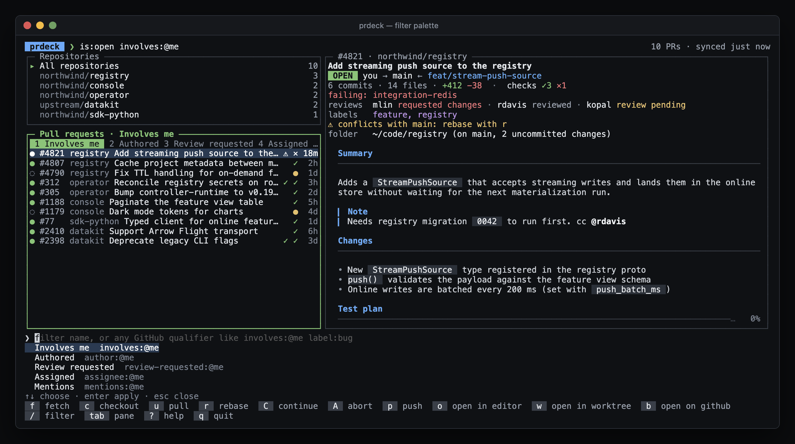
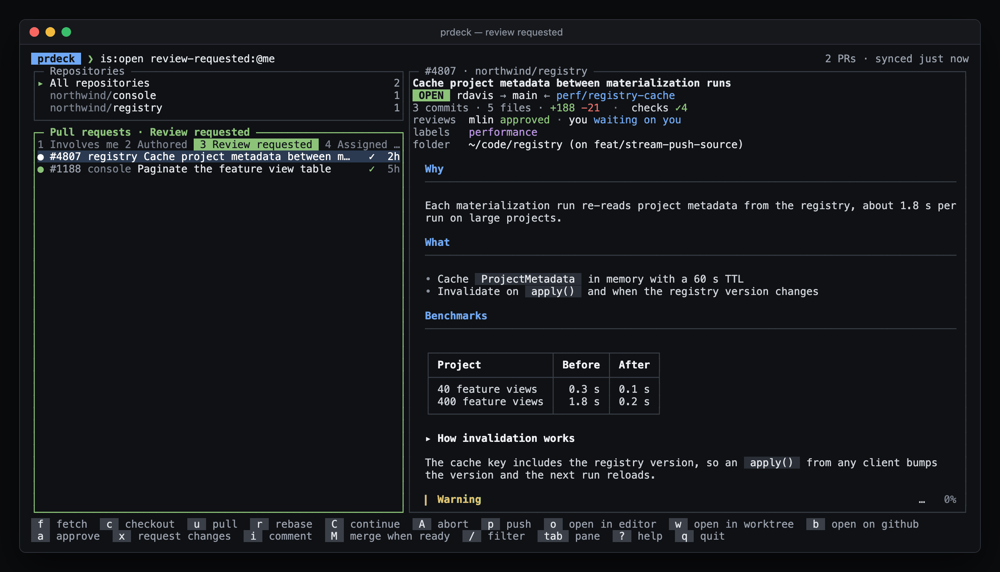
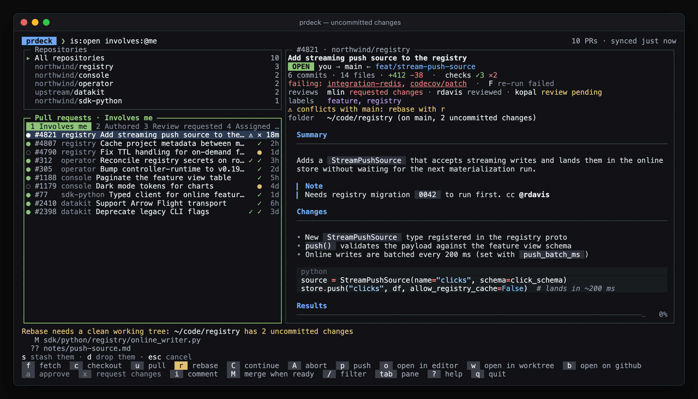
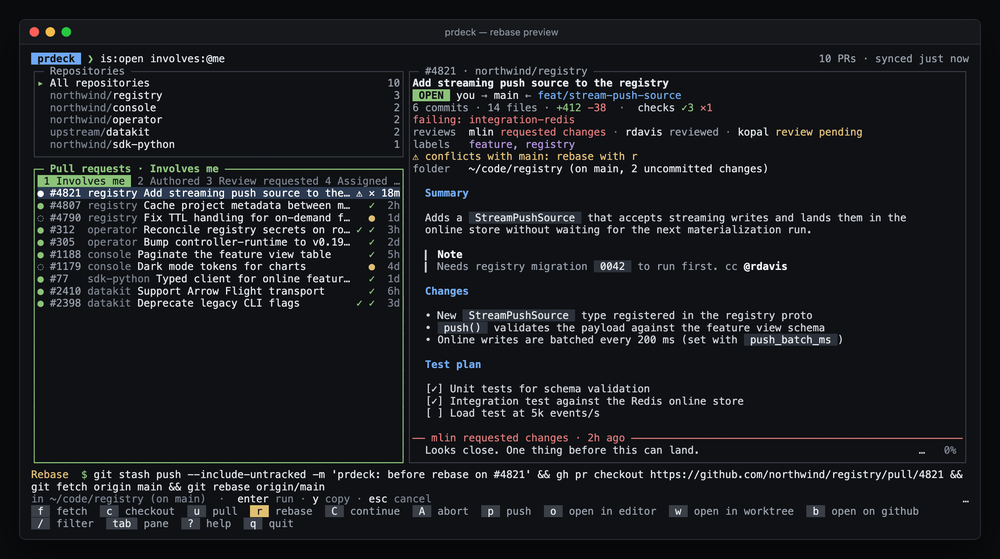
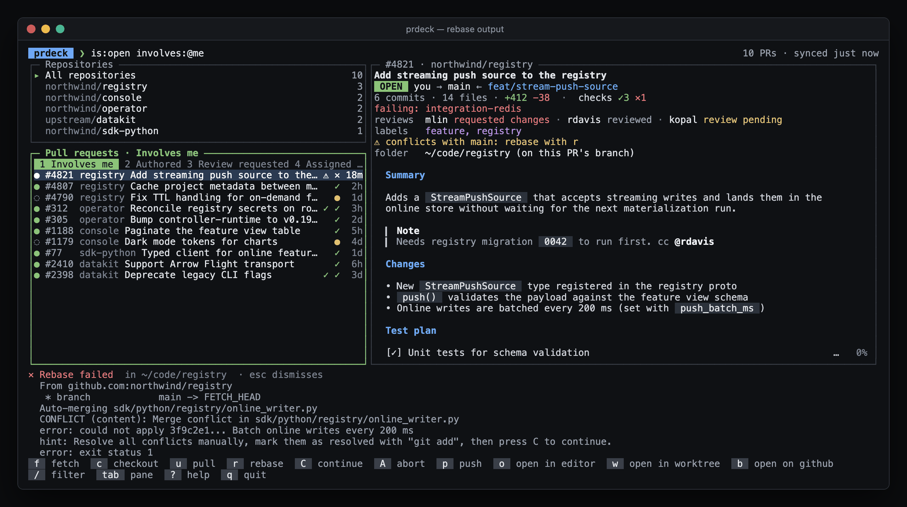
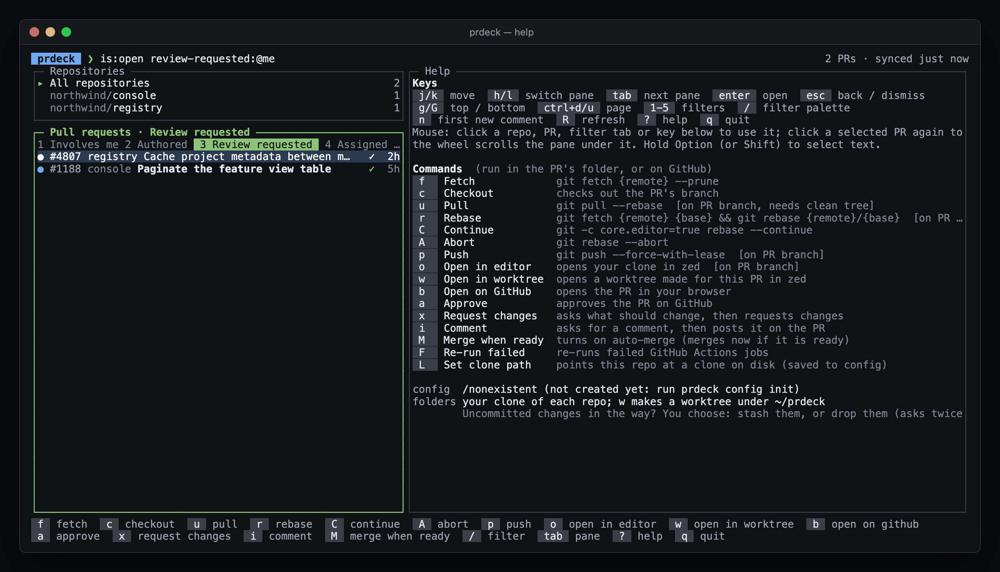

# prdeck

A terminal dashboard for the pull requests you're involved in. Pick a PR, read it the way GitHub shows it, then fetch, rebase, push or open it in your editor with one key.


| | |
| --- | --- |
|  |  |
| **`/` filter palette**: pick a filter or type any GitHub qualifier | **`3` Review requested**: who is waiting on you |
|  |  |
| **Uncommitted changes**: stash or drop them first, your choice | **`r` rebase**: the exact commands, run only on `enter` |
|  |  |
| **Output**: conflicts show right away; fix them, then `C` | **`?` help**: every key and the command it runs |

Screenshots use sample data from `prdeck demo`. Regenerate them with `scripts/screenshots/capture.sh`.

## Install

Needs Go 1.26+, `git`, and the GitHub CLI signed in (`gh auth login`). prdeck uses your gh login; it never stores a token.

```bash
git clone https://github.com/patelchaitany/prdeck && cd prdeck
go build -o ~/.local/bin/prdeck ./cmd/prdeck
```

## Use

```bash
prdeck                     # the dashboard
prdeck demo                # try it with sample PRs: no GitHub needed, commands don't run
prdeck list                # print your PRs (first filter)
prdeck list author:@me     # any GitHub search qualifier
prdeck config init         # write a starter config
```

| Key | What it does |
| --- | --- |
| `j` `k` / arrows | Move |
| `h` `l` / `tab` | Switch pane (repos, PRs, PR view) |
| `1`–`9` | Switch filter (Involves me, Authored, Review requested, Assigned, Mentions) |
| `/` | Filter palette: pick a filter or type any qualifier (`label:bug repo:org/x`) |
| `R` | Refresh now (it also refreshes every 2 minutes) |
| `f` `c` `u` | Fetch, check out the PR's branch, pull |
| `r` `C` `A` | Rebase on the base branch, continue, abort |
| `p` | Push with `--force-with-lease` |
| `o` | Check out the PR's branch and open your clone in your editor (Zed by default) |
| `w` | Open the PR in a separate git worktree instead |
| `b` | Open the PR on GitHub |
| `L` | Find your clone of this repo with fuzzy search; saved to the config |
| `?` | Help: every key and the exact command it runs |
| Mouse | Click a repo, PR, filter tab or a key in the bottom bar; click the selected PR again to open it; the wheel scrolls the pane under it |

PR descriptions and comments render like on GitHub: headings, tables, task lists, code, alerts (`> [!NOTE]`), `<details>` sections, `@mentions`, suggestion blocks, and images as `[image: …]` links.

With mouse support on, hold Option (or Shift, depending on your terminal) to select text. Set `ui.mouse: false` to turn it off.

Commands that rewrite history (rebase, abort, push) show the exact command first and run on `enter`; `y` copies it, `esc` cancels.

### Where commands run

Commands run in **your existing clone** of the PR's repo. The PR view's `folder` line shows which clone, what it has checked out, and whether it has uncommitted changes.

- **Branch:** checkout, pull, rebase, push and open first check out the PR's branch (`gh pr checkout`, which also handles PRs from forks). Fetch, continue and abort run as they are.
- **Uncommitted changes:** when a command would switch branches or needs a clean tree (pull, rebase), prdeck lists the changes and asks: `s` stash them (`git stash push --include-untracked`, so nothing is lost), `d` drop them (asks a second time, then `git reset --hard` and `git clean -fd`), or `esc` to cancel.
- **Worktrees** are made only when you ask: `w` opens the PR in `~/prdeck/<repo>-<number>`, leaving your clone alone. Set `editor.worktree: true` to use a worktree for every command. If the PR's branch is already checked out in a worktree, prdeck uses that one.

**Finding your clone.** prdeck scans `~/projects`, `~/code` and `~/src` (two levels deep) for GitHub remotes. If a repo isn't there, the first command on it searches your home folder and lists the clones it finds; pick one with `1`–`9`, search for it with `p`, or clone it with `c`. Press `L` any time to point a repo at a different clone.

The clone search (`L` or `p`) is fuzzy, like fzf: it lists every git clone under your home folder, with clones of this repo first, and narrows as you type (`odh fea` finds `~/projects/odh-feast/feast`). Pick with `↑↓` and `enter` or a click; `tab` copies the path into the box to edit; a typed path (`~/work/x`) can be used as is. Your choice is saved under `repos.paths` in the config, so you only do it once.

## Configuration

`~/.config/prdeck/config.yaml` (or `$PRDECK_CONFIG`). Everything is optional. `prdeck config init` writes a commented starter file.

```yaml
editor:
  default: cursor              # zed | vscode | cursor | nvim, or your own
  editors:
    helix: {run: hx {path}, terminal: true}

filters:
  - name: Waiting on me
    query: review-requested:@me -is:draft

commands:
  - name: Run tests
    key: t
    run: make test
    branch: true               # check out the PR's branch first
    output: terminal           # panel (default) | terminal | silent
  - name: Squash into one commit
    key: S
    run: git reset --soft $(git merge-base HEAD {remote}/{base}) && git commit -m {title}
    branch: true
    clean: true                # asks to stash or drop changes first
    when: authored             # only on your own PRs
    confirm: true
  - name: Push
    key: P                     # same name as a built-in: overrides just the key
  - name: Abort
    hidden: true               # removes a built-in
```

**Command fields:** `name`, `key`, `run`, `bar` (show in the bottom bar), `confirm`, `prompt` (asks for text, fills `{input}`), `output`, `branch` (check out the PR's branch first), `clean` (needs no uncommitted changes), `worktree` (run in a worktree for the PR), `when` (`authored`, `others`, `draft`, `ready`, `ci_failed`, `conflict`), `hidden`.

**Placeholders:** `{number}` `{branch}` `{base}` `{repo}` `{owner}` `{name}` `{title}` `{author}` `{url}` `{remote}` (the remote that points at the PR's repo) `{path}` (the PR folder) `{input}`. Values are shell-quoted, so a PR title can never run as a command.

Keys `j k q ? / R 1-9` are kept for navigation.

## How it's built

One Go core (`internal/core`, `config`, `github`, `cache`, `repos`, `runner`) behind a Bubble Tea front-end (`internal/tui`). GitHub data comes from the GraphQL API through [go-gh](https://github.com/cli/go-gh); PR text is rendered with [Glamour](https://github.com/charmbracelet/glamour). The same core is meant to back a Mac app later.

```bash
go test ./...
```

## Roadmap

1. **Core** — config, GitHub search, cache, `prdeck list`. Done.
2. **Terminal app** — panes, PR view, command bar, worktree per PR, open in editor. Done.
3. **Conversations** — reply, review, resolve threads; repo-level `.prdeck.yaml` commands with a trust prompt.
4. **Mac app** — native window from the same core, notifications, Homebrew.
