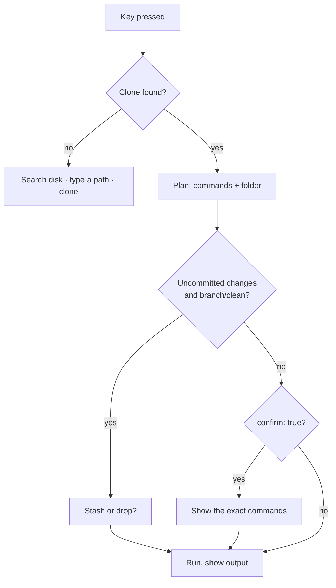

# 0004. Commands run in your clone; worktrees only on request

- Status: accepted
- Date: 2026-11-03

## Context

To rebase or open a PR, PR Deck needs a checkout of its repo. It could make a fresh worktree per PR, or use the clone you already have. Worktrees are clean but surprising: new folders appear, your editor opens somewhere new, and build caches start from zero.

## Decision

- Commands run in your existing clone. PR Deck finds it in `repos.scan` folders (two levels deep) or `repos.paths`.
- A worktree is used only when asked: the `w` command (Open in worktree), `worktree: true` on a command, or `editor.worktree: true` for everything. An existing worktree that already has the PR's branch is reused.
- Before a command that switches branch (`branch: true`) or needs a clean tree (`clean: true`), PR Deck checks for uncommitted changes. If there are any, it lists them and asks: stash (`git stash push --include-untracked -m "prdeck: before …"`) or drop (`git reset --hard && git clean -fd`, ignored files stay). Dropping needs a second press.
- No clone found: PR Deck searches the home folder for one, lets you pick it or type a path (saved to `repos.paths`), or offers `gh repo clone`.
- You can point a repo at a different clone any time: `L` in the terminal, "Use another clone…" under Local clone in the desktop app (a folder picker, the clones found on disk, or a typed path). It is saved to `repos.paths` and used for every PR of that repo.
- New worktrees go in `editor.worktree_dir` (`~/prdeck`). In the desktop app a command that would make a new worktree waits and shows where it goes; "Change folder…" picks another folder, which is saved as the new `worktree_dir`. A folder inside a clone is refused, since every worktree would show up in it as untracked files.
- A worktree whose folder was deleted (by hand, or a temp folder another tool cleaned up) still holds its branch in git, which then refuses to check the branch out anywhere else. Just before a checkout needs the branch, PR Deck unregisters that worktree, unless its folder may be on a disk that is not mounted right now (under `/Volumes`, `/mnt` or `/media`).
- A rebase already in progress is detected, and `C` / `A` continue or abort it.

## Consequences

- PR Deck feels like your own terminal: the same folder, the same editor window, the same build cache.
- Nothing is ever thrown away without being shown first.
- The clone's branch changes under you when you check out a PR; the footer always shows which branch the clone is on.

## Alternatives considered

- **A worktree per PR by default.** Safe, but it fills the disk and splits your editor across folders. Kept as an opt-in.
