# How PR Deck is designed

PR Deck shows the open pull requests you are involved in, renders each one the way GitHub does, and runs git commands on its branch with one key. It comes as a terminal app (`prdeck`) and a macOS app (PR Deck.app). Both are front-ends over one Go core.

This folder holds the architecture decision records (ADRs): one short file per decision, saying what was decided, why, and what it costs. Read this page for the overall shape, then the records for the reasons.

## The two apps

**Terminal** (`prdeck`)

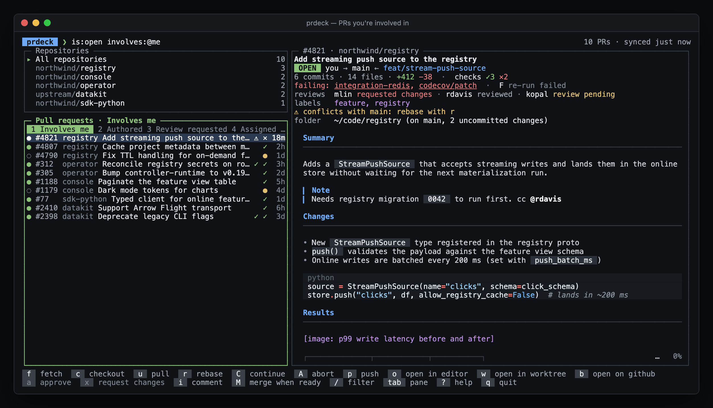

**Desktop** (PR Deck.app)

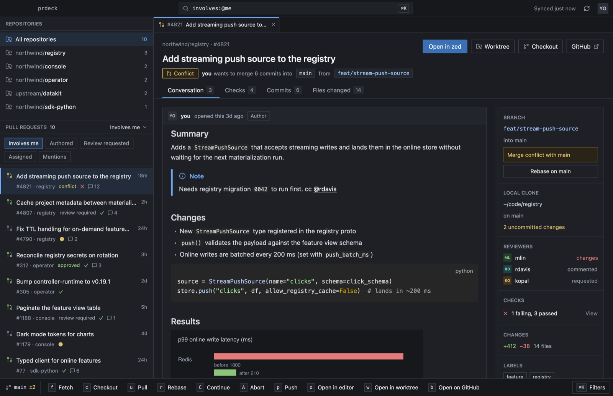

| | |
| --- | --- |
| 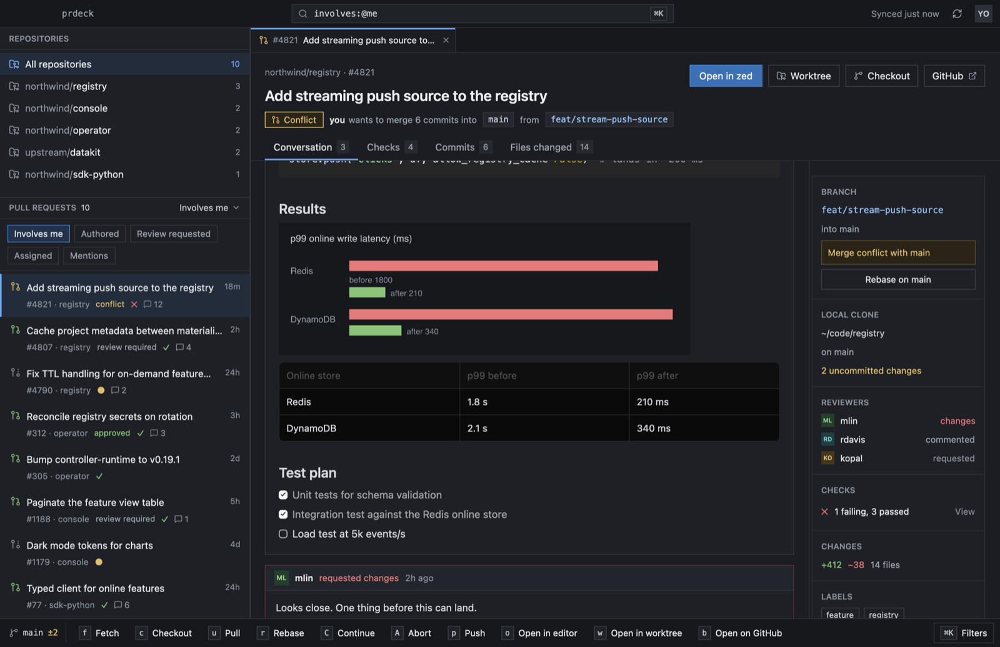 | 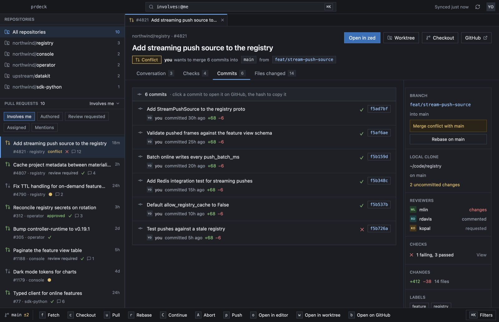 |
| PR text as on github.com: images, tables, code, alerts | Commits and changed files from GitHub |
| 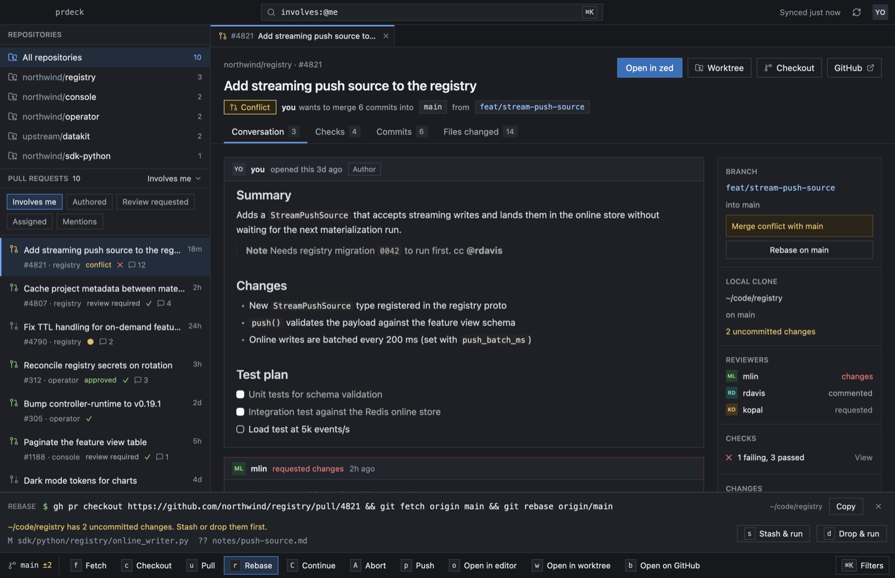 | 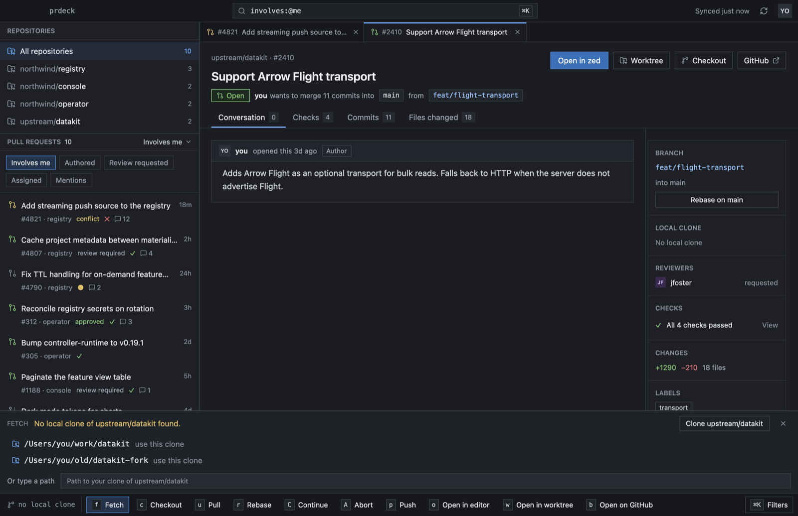 |
| A command meets uncommitted work: stash or drop, your choice | No clone of the repo: pick one found on disk, or clone it |
| 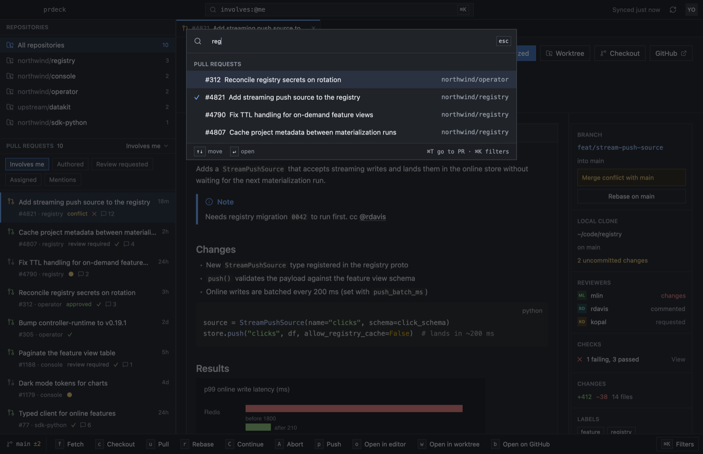 | 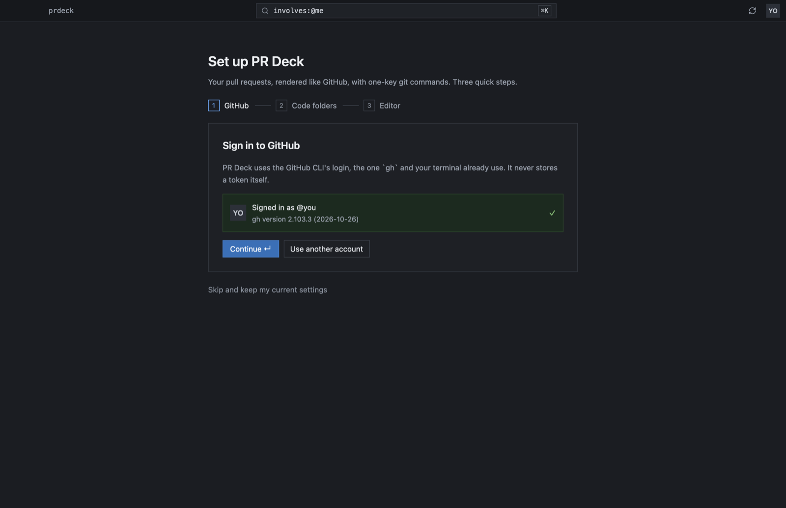 |
| `⌘T` jumps to any PR | First-run setup: GitHub sign-in, folders, editor |
| 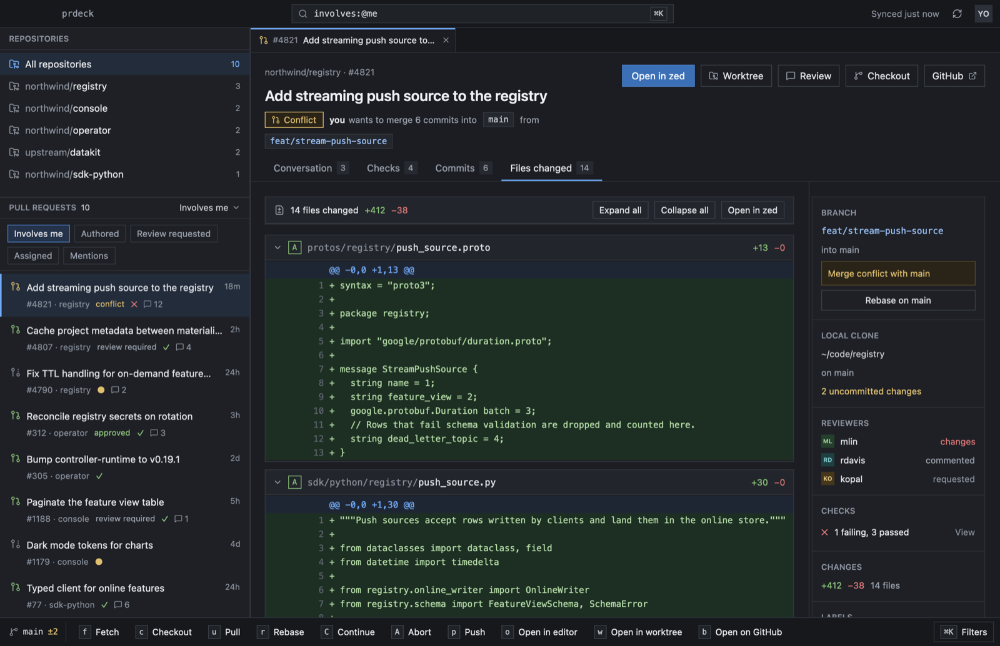 | 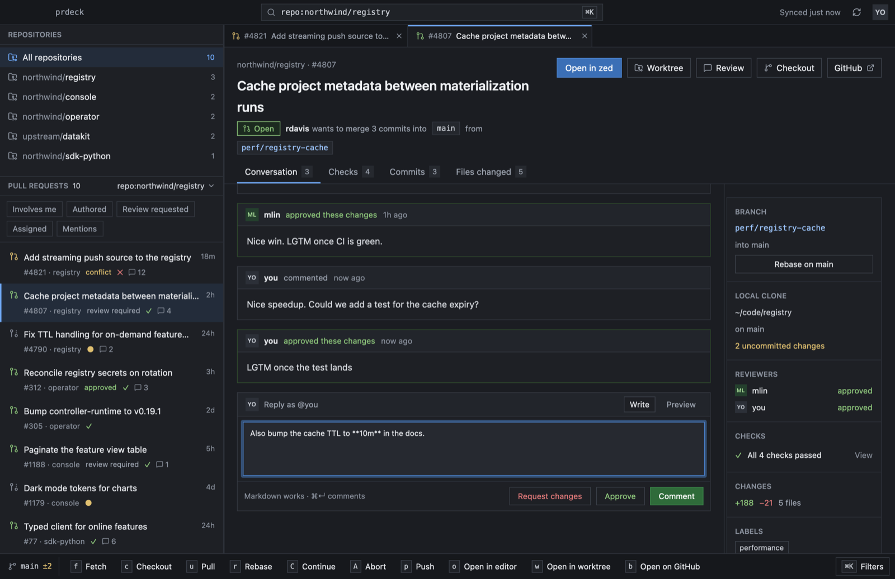 |
| Every changed file's diff, each one collapsible | Comment, approve or request changes, reply on threads |
| 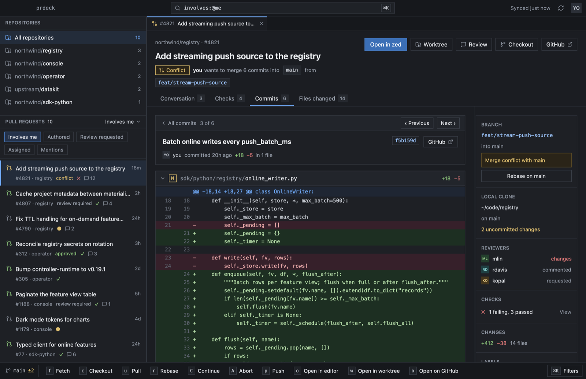 | |
| A commit opened: message, author and what it changed | |

All screenshots use the sample data from `prdeck demo` / `--demo`.

## The shape

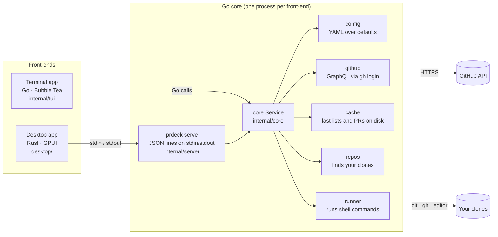

The terminal app links the core directly. The desktop app starts the same binary as `prdeck serve` and talks to it over a pipe, so both apps read the same config, run the same commands, and find the same clones.

### Opening a PR and running a command

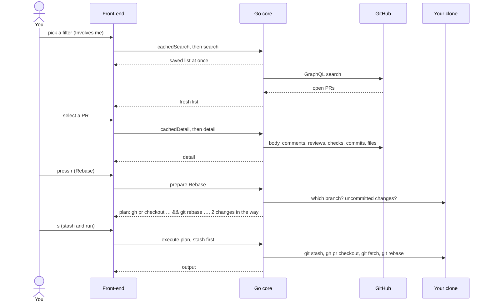

## Where things live

| Path | What it does |
| --- | --- |
| `cmd/prdeck` | The binary: the terminal app, `list`, `demo`, `config`, and `serve` for the desktop app. |
| `internal/config` | Loads `~/.config/prdeck/config.yaml`, merges it over the built-in defaults, and edits it in place (keeping comments). |
| `internal/github` | GitHub GraphQL with the gh login: search, PR detail, the viewer, image downloads. |
| `internal/cache` | The last PR lists and PR details as JSON, so both apps open instantly. |
| `internal/repos` | Finds clones on disk, reads their branch and uncommitted changes, plans worktrees. |
| `internal/runner` | Fills `{placeholders}` (shell-quoted) and runs commands with `/bin/sh -c`. |
| `internal/core` | `Service`: ties the above together; turns a command into a `Plan` and runs it. |
| `internal/server` | `prdeck serve`: the core as one-JSON-object-per-line requests; first-run setup. |
| `internal/tui`, `internal/mdrender`, `internal/termout` | The terminal app, its markdown renderer, and its terminal writer. |
| `internal/demo` | Sample PRs and pretend clones for `prdeck demo`, `--demo` and the screenshots. |
| `desktop/src` | The desktop app: window (`deck.rs`), setup (`deck/setup.rs`), PR text (`markdown.rs`), the pipe to the core (`rpc.rs`). |

## Decisions

| # | Decision |
| --- | --- |
| [0001](0001-one-go-core-two-front-ends.md) | One Go core behind both apps |
| [0002](0002-github-through-the-gh-login.md) | Talk to GitHub through the gh login and GraphQL |
| [0003](0003-yaml-config-and-custom-commands.md) | One YAML file for settings and custom commands |
| [0004](0004-commands-run-in-your-clone.md) | Commands run in your clone; worktrees only on request |
| [0005](0005-show-saved-data-then-refresh.md) | Show saved data at once, then refresh |
| [0006](0006-own-terminal-markdown-renderer.md) | Our own markdown renderer for the terminal |
| [0007](0007-terminal-output-never-blocks-input.md) | Terminal output never blocks input |
| [0008](0008-desktop-app-in-rust-with-gpui.md) | The desktop app is Rust and GPUI |
| [0009](0009-desktop-uses-the-core-over-prdeck-serve.md) | The desktop app uses the core over `prdeck serve` |
| [0010](0010-pr-text-rendered-like-github.md) | PR text on the desktop is rendered like github.com |
| [0011](0011-first-run-setup.md) | First-run setup signs in through gh |
| [0012](0012-comment-and-review-from-the-app.md) | Comment and review from the app |
| [0013](0013-diffs-in-the-app.md) | Diffs in the app |

To add a record, copy the shape of an existing one (Status, Context, Decision, Consequences, Alternatives) and give it the next number. A record is not rewritten when things change; a new one supersedes it.
